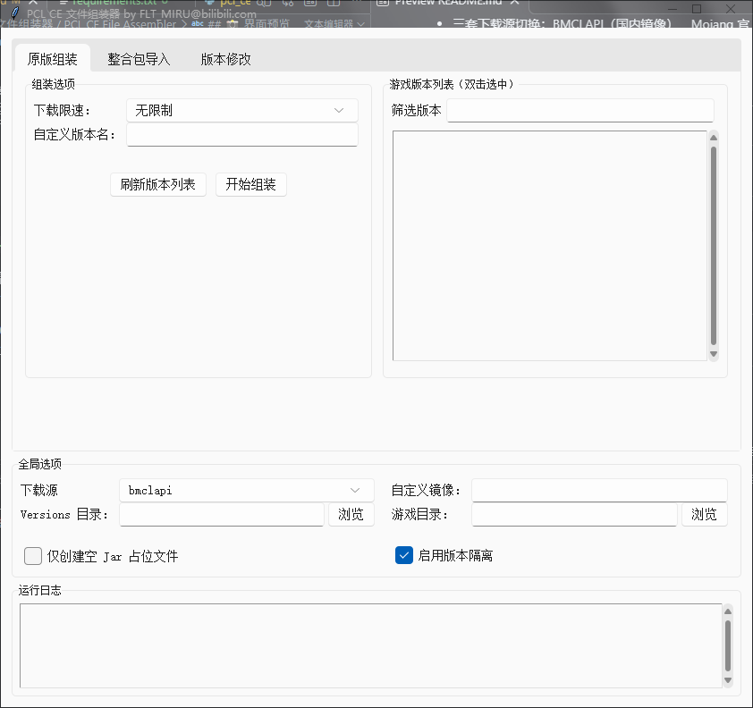
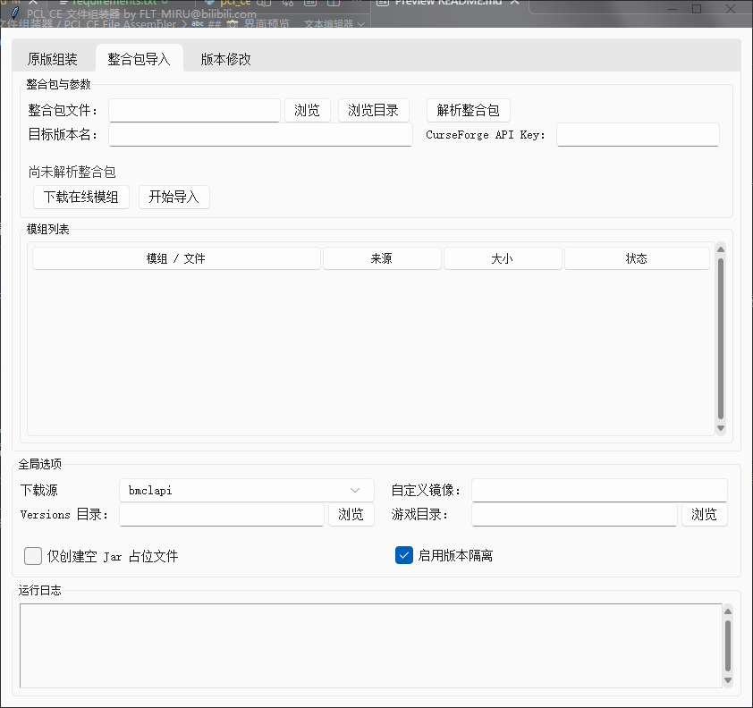
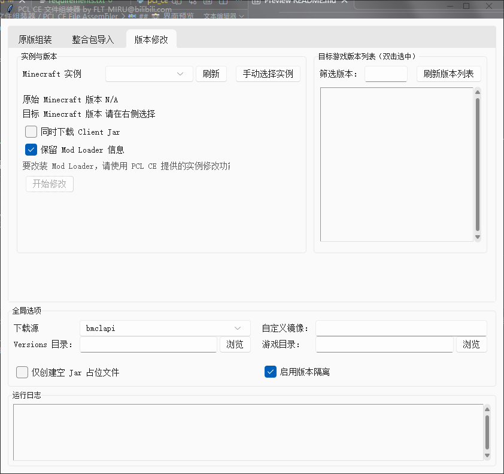

# PCL CE 文件组装器 / PCL CE File Assembler

> 一个基于 Python + Tkinter 的 PCL CE 辅助工具，用于一键组装原版 Minecraft 版本、导入第三方整合包、以及在保留 Mod Loader 的前提下修改已有实例的游戏版本。

!\[Python]([https://img.shields.io/badge/Python-3.8+-blue?logo=python&logoColor=white](https://img.shields.io/badge/Python-3.8+-blue?logo=python&logoColor=white))
!\[License]([https://img.shields.io/badge/license-MIT-green](https://img.shields.io/badge/license-MIT-green))
!\[Platform]([https://img.shields.io/badge/platform-Windows%20%7C%20Linux%20%7C%20macOS-lightgrey](https://img.shields.io/badge/platform-Windows%20%7C%20Linux%20%7C%20macOS-lightgrey))

***

## 📖 项目简介

**PCL CE File Assembler** 是一个独立的桌面 GUI 工具，服务于 [PCL CE（Plain Craft Launcher Community Edition）](https://github.com/PCL-Community/Plain-Craft-Launcher-CE) 启动器。它解决了以下几个常见痛点：

- PCL CE 初次拉取版本时网络不稳定 / 速度慢；
- 从 Modrinth、CurseForge 下载的整合包需要手动拆解、手动投放模组；
- 想把一个装好了 Forge/Fabric 的实例"跨版本"升级或降级，但又不想丢失 Mod Loader 配置。

本工具在本地完成版本 JSON、client.jar、natives 目录、模组文件的组装与校验，生成结果可直接被 PCL CE 识别。

> 截图占位：`docs/screenshot-main.png`
>
> 

***

## ✨ 功能特性

### 🟦 原版组装

- 从 Mojang 官方 / BMCLAPI / 自定义镜像获取 `version_manifest_v2.json`
- 按 Release / Snapshot / Old Beta / Old Alpha 分组展示全部游戏版本
- 支持版本名搜索过滤、双击选中
- 自动下载版本配置 JSON 与 `client.jar`，并进行 **SHA1 校验**
- 可选择"仅创建空 Jar 占位文件"，配合 PCL CE 的"修补核心"功能使用
- 支持下载限速（500 KB/s ~ 4 MB/s）
- 自动创建 `versions/<版本名>/<版本名>-natives/` 目录

### 📦 整合包导入

- 支持 **Modrinth .mrpack**（解析 `modrinth.index.json`）
- 支持 **CurseForge .zip**（解析 `manifest.json`）
- 支持 **MultiMC / Prism Launcher 实例目录**（读取 `mmc-pack.json` / `instance.cfg`）
- 自动识别目标游戏版本与 Mod Loader（Forge / NeoForge / Fabric / Quilt）
- 内置文件（overrides、资源包、配置文件）自动释放到目标目录
- 在线模组通过 Modrinth / CurseForge API 并发下载（4 线程）
- CurseForge 模组需要填写 **CurseForge API Key**
- 支持版本隔离开关：模组写入独立版本目录或共享游戏目录

### 🔧 版本修改

- 自动扫描 PCL CE `versions/` 目录下的已有实例
- 智能识别实例使用的 Mod Loader（Forge / NeoForge / Fabric / Quilt）
- 切换目标 Minecraft 版本时，**自动拉取对应 Loader 的官方元数据并合并配置**
- 可选保留 / 移除 Mod Loader 信息
- 可选同时重新下载 `client.jar`

### 🌐 全局选项

- 三套下载源切换：BMCLAPI（国内镜像）、Mojang 官方、自定义镜像地址
- 实时路径合法性校验与错误提示
- 运行日志窗口，所有下载与解析过程可追溯
- 下载进度独立弹窗，显示当前文件、已下载字节 / 总字节、百分比

***

## 📸 界面预览

> 以下演示已安装`sv-ttk`

| 原版组装 | 整合包导入 | 版本修改 |
| --- | --- | --- |
|  |  |  |

***

## 🚀 快速开始

### 环境要求

- **Python 3.8 或更高版本**
- 操作系统：Windows / Linux / macOS（Tkinter 需系统自带，Linux 可能需要 `sudo apt install python3-tk`）

### 安装依赖

```bash
git clone https://github.com/FltMiru/pcl-ce-assembler_enhanced
cd pcl-ce-assembler
pip install requirements.txt
#可选步骤
pip install sv-ttk
```

### 运行

```bash
python pcl_ce_assembler_enhanced.py
```

### 使用流程

1. **设置全局选项**

    - 填写 PCL CE 的 `versions` 目录路径（通常是 `.minecraft/versions`）
    - 如启用版本隔离，可同时填写游戏目录（`.minecraft`）
    - 下载源推荐选择 `bmclapi`（国内网络）

2. **组装原版版本**

    - 点击"刷新版本列表"，等待版本清单加载
    - 双击选中想要的游戏版本
    - （可选）填写自定义版本名
    - 点击"开始组装"

3. **导入整合包**

    - 切换到"整合包导入"标签页
    - 浏览选择 `.mrpack` / `.zip` 整合包文件，或 MultiMC 实例目录
    - 填写 CurseForge API Key（仅 CurseForge 整合包需要）
    - 点击"解析整合包"，确认解析出的版本与模组列表
    - 点击"下载在线模组"先下载模组，或直接点击"开始导入"一键完成

4. **修改已有实例版本**

    - 切换到"版本修改"标签页
    - 选择要修改的实例（或手动选择实例文件夹）
    - 在右侧列表双击目标 Minecraft 版本
    - 根据需要勾选"保留 Mod Loader 信息"
    - 点击"开始修改"

完成后打开 PCL CE，刷新版本列表即可看到新组装的版本。

***

## 🔑 获取 CurseForge API Key

CurseForge 官方 API 要求携带 API Key 才能下载模组文件。获取方式：

1. 前往 [CurseForge Console](https://console.curseforge.com/)
2. 注册 / 登录后创建一个 API Key
3. 将 Key 粘贴到本工具"整合包导入"标签页的对应输入框中

> 没有 Key 也可以使用 Modrinth 整合包，Modrinth 下载不需要鉴权。

***

## 📁 目录结构

```
pcl-ce-assembler/
├── pcl_ce_assembler.py
├── README.md
├── requirements.txt
```

***

## ⚙️ 技术说明

| 模块 | 实现方式 |
| --- | --- |
| GUI | Tkinter + ttk，可选 sv-ttk 主题 |
| 网络请求 | `requests`（stream 分片下载） |
| 并发 | `ThreadPoolExecutor`（模组下载 4 并发） |
| 版本清单 | Mojang `launchermeta` / BMCLAPI 镜像自动回退 |
| 校验 | SHA-1 文件哈希比对，失败自动重试 3 次 |
| Loader 元数据 | FabricMC Meta、QuiltMC Meta、Forge Promotions、NeoForge Maven |
| 路径安全 | `Path.resolve()` + `is_relative_to()` 防目录穿越 |

### 支持的 Mod Loader 自动合并

- **Fabric**：从 [`meta.fabricmc.net`](http://meta.fabricmc.net) 获取对应 MC 版本的最新稳定 loader 与 intermediary，拉取 profile JSON 后合并 libraries / arguments / mainClass
- **Quilt**：从 [`meta.quiltmc.org`](http://meta.quiltmc.org) 获取，流程同 Fabric
- **Forge**：从 [`files.minecraftforge.net`](http://files.minecraftforge.net) 的 `promotions_slim.json` 获取 recommended / latest 构建号
- **NeoForge**：从 [`maven.neoforged.net`](http://maven.neoforged.net) 解析 `maven-metadata.xml` 并匹配对应 MC 版本

***

## ❓ 常见问题

**Q: 组装完成后 PCL CE 里版本是红色 / 打不开？**
A: 在 PCL CE 中选中该版本，点击"修补核心"补全缺失文件即可。如果勾选了"仅创建空 Jar 占位文件"，这一步是必须的。

**Q: CurseForge 整合包下载模组失败？**
A: 请确认已填写有效的 CurseForge API Key，且网络可访问 [`api.curseforge.com`](http://api.curseforge.com)。

**Q: Linux 下运行报 `ModuleNotFoundError: No module named '_tkinter'`？**

A: 
Ubuntu / Debian 请执行 `sudo apt install python3-tk`；
Fedora / RHEL 请执行 `sudo dnf install python3-tkinter`。

**Q: BMCLAPI 是什么？**
A: [BMCLAPI](https://bmclapidoc.bangbang93.com/) 是国内社区维护的 Minecraft 资源加速镜像，能显著提升国内用户的下载速度。

***

## 📝 开源协议

本项目基于 [MIT License](LICENSE) 开源，可自由使用、修改与分发。

***

## 🙏 致谢

- [Plain Craft Launcher CE](https://github.com/PCL-Community/Plain-Craft-Launcher-CE)
- [BMCLAPI](https://bmclapidoc.bangbang93.com/)
- [Modrinth](https://modrinth.com/)
- [CurseForge](https://www.curseforge.com/)
- [FabricMC](https://fabricmc.net/)
- [QuiltMC](https://quiltmc.org/)
- [Forge](https://files.minecraftforge.net/)
- [NeoForge](https://neoforged.net/)
***

> 作者：FLT_MIRU@bilibili.com [打开主页](https://space.bilibili.com/1569663198)
>
> 如果本工具对你有帮助，欢迎 Star ⭐ 支持！